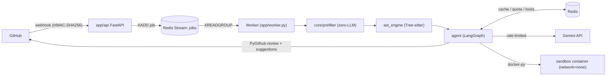
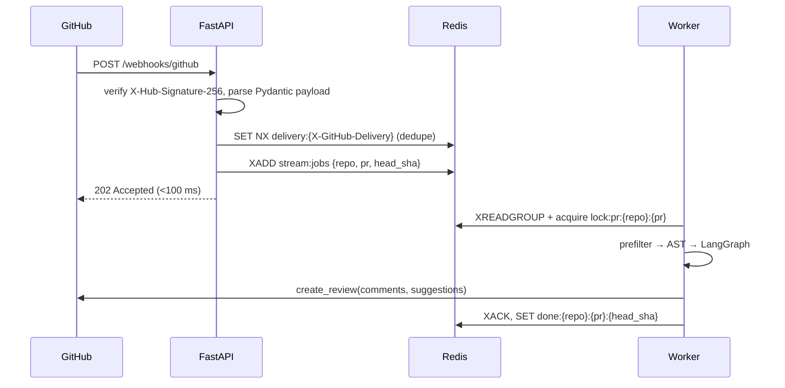
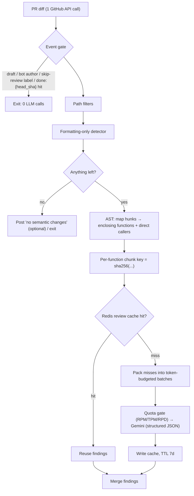
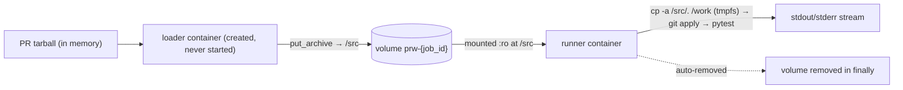
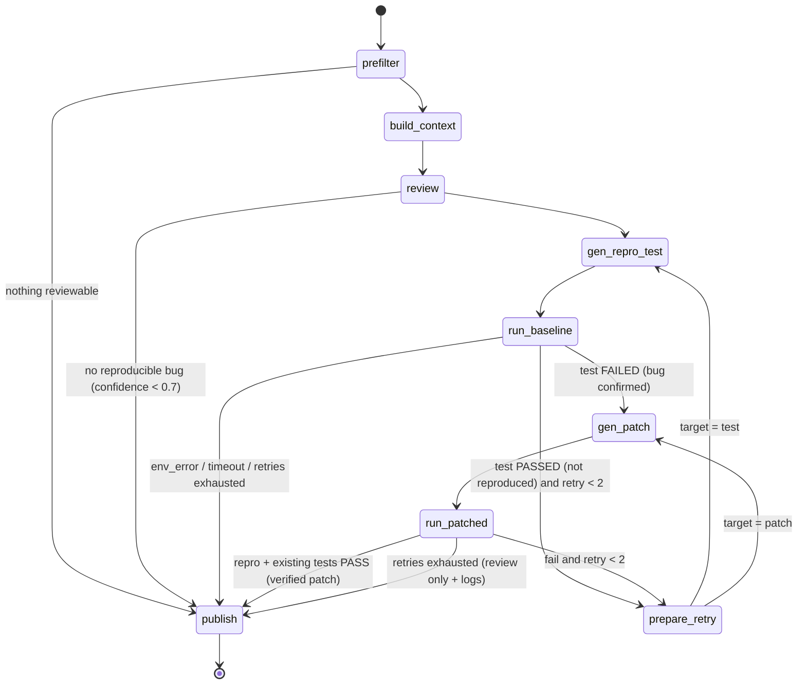

# ARCHITECTURE — Autonomous GitHub PR Review, Bug-Finding & Patching Agent

> Status: **approved (v1 decisions in §9)**. Phase 1 (foundation and orchestration) is implemented. Later phases follow §8.

## 0. Goal & Design Principles

The agent receives GitHub `pull_request` webhooks, reviews **only the parts of a diff that change meaning**, tries to **reproduce** suspected bugs with a generated test in an **isolated Docker sandbox**, and proposes a **verified patch**. It has to stay within **free-tier Gemini quotas** (single-digit requests per minute, a few hundred requests per day).

| Principle | Consequence |
|---|---|
| **Make LLM calls the last resort** | Deterministic pre-filters → cache → AST-trimmed context → batched prompts |
| **Treat untrusted code as hostile** | PR code and LLM patches run **only** in ephemeral, network-less, resource-capped containers. The host never runs `git apply` on LLM output |
| **Always terminate** | Hard `max_retries=2`, a per-job LLM-call budget, and LangGraph `recursion_limit` as a backstop |
| **Make jobs idempotent** | Every unit of work is keyed by a content SHA. Redelivered webhooks and rebases cost nothing |
| **Type everything** | Pydantic v2 for payloads, state, LLM I/O, and sandbox results. `mypy --strict` clean |

---

## 1. System Overview





---

## 2. Modular Directory Layout

```
PR-review-agent/
├── .antigravityrules
├── ARCHITECTURE.md
├── README.md
├── pyproject.toml                # deps, ruff, mypy, pytest config
├── docker-compose.yml
├── .env.example
├── .gitignore
├── .dockerignore
├── docker/
│   ├── app.Dockerfile            # FastAPI + worker image
│   └── sandbox-python.Dockerfile # minimal runner: python3.11, pytest, git; non-root
├── app/
│   ├── main.py                   # FastAPI app factory, lifespan (Redis pool)
│   ├── worker.py                 # stream consumer loop → runs the graph
│   ├── api/
│   │   ├── routes_webhook.py     # POST /webhooks/github
│   │   ├── routes_health.py      # /healthz, /readyz (Redis + Docker ping)
│   │   ├── security.py           # HMAC verify (hmac.compare_digest)
│   │   └── schemas.py            # Pydantic: PullRequestEvent, Repo, PR, ...
│   ├── core/
│   │   ├── config.py             # pydantic-settings Settings (SecretStr secrets)
│   │   ├── logging.py            # structured JSON logs, secret redaction
│   │   ├── redis_client.py       # async pool factory
│   │   ├── queue.py              # Redis Streams producer/consumer + delayed ZSET
│   │   ├── locks.py              # per-PR distributed lock + supersede token
│   │   ├── cache.py              # SHA-keyed review / AST / sandbox caches
│   │   ├── rate_limiter.py       # Gemini RPM/TPM/RPD token buckets (Lua, atomic)
│   │   ├── diff_parser.py        # unified diff → FileDiff/Hunk models (unidiff)
│   │   └── prefilter.py          # zero-LLM filtering rules (§3.1)
│   ├── integrations/
│   │   └── github_client.py      # PyGithub wrapper: diff, blobs, tarball, review post
│   ├── ast_engine/
│   │   ├── languages.py          # ext → tree-sitter grammar registry
│   │   ├── parser.py             # parse bytes → Tree, cached by blob SHA
│   │   ├── symbols.py            # function/method/class defs w/ line spans
│   │   ├── callers.py            # call-site extraction & direct-caller resolution
│   │   ├── index.py              # repo symbol index (defs + call sites)
│   │   └── context_builder.py    # token-budgeted ASTContext assembly
│   ├── sandbox/
│   │   ├── models.py             # SandboxSpec, SandboxResult
│   │   ├── workspace.py          # tarball → per-job Docker volume (no host bind paths)
│   │   └── runner.py             # create/attach/start/wait/kill/remove
│   └── agent/
│       ├── state.py              # ReviewState (Pydantic) + sub-models
│       ├── llm.py                # google-genai client, structured output, quota gate
│       ├── prompts/              # versioned prompt templates (PROMPT_VERSION)
│       ├── nodes/                # prefilter, context, review, repro, sandbox, patch, publish
│       ├── edges.py              # pure routing functions
│       └── graph.py              # StateGraph build + compile
└── tests/
    ├── conftest.py               # fakeredis, fake settings, fixture loaders
    ├── fixtures/                 # sample payloads, diffs, mini repos
    ├── api/  core/  ast_engine/  sandbox/  agent/   # mirror app/
    └── integration/              # @pytest.mark.docker / @pytest.mark.e2e (opt-in)
```

**Dependency rule:** `api → core`, and `agent → {core, ast_engine, sandbox, integrations}`. `ast_engine` and `sandbox` never import `agent`. `core` imports nothing internal except `config`.

---

## 3. Quota-Protection Pipeline



### 3.1 Zero-LLM static pre-filter (`core/prefilter.py`)

Every rule is a pure function `(FileDiff) -> SkipReason | None`, so each one is unit-testable. Rules run cheapest-first:

| Stage | Rule | Examples |
|---|---|---|
| Event gate | Skip drafts, bot authors (`dependabot[bot]`, `renovate[bot]`), `skip-ai-review` label, unsupported actions | Only `opened`, `synchronize`, `reopened`, `ready_for_review` pass |
| Lockfiles | Exact basename match | `package-lock.json`, `yarn.lock`, `pnpm-lock.yaml`, `poetry.lock`, `Pipfile.lock`, `uv.lock`, `Cargo.lock`, `go.sum`, `composer.lock`, `Gemfile.lock` |
| Docs / non-code | Glob match | `*.md`, `*.rst`, `*.txt`, `docs/**`, `LICENSE*`, `CHANGELOG*`, `.github/ISSUE_TEMPLATE/**` |
| Binary / assets | `binary` diff flag or ext | images, fonts, `*.pdf`, `*.zip` |
| Generated / vendored | Glob or header marker | `vendor/**`, `dist/**`, `build/**`, `*.min.js`, `*_pb2.py`, `*.pb.go`; first 5 lines contain `@generated` / `DO NOT EDIT` |
| Deletions only | File removed, or hunks contain only `-` lines | (callers of deleted symbols are still flagged by the AST stage in a later version) |
| Unsupported language | No registered grammar | Skipped from AST/LLM. Listed as "not reviewed" in the summary |
| **Formatting-only** | see below | whitespace, re-indentation, comment-only edits |
| Size guard | > `MAX_PR_CHANGED_LINES` after filtering | Falls back to reviewing only the top-N most-changed functions, and says so |

**How formatting-only changes are detected (strongest available signal wins):**
1. **Python:** `ast.dump(ast.parse(base_src)) == ast.dump(ast.parse(head_src))` means no semantic change. This ignores whitespace, comments, and line wrapping.
2. **Other Tree-sitter languages:** compare the sequence of `(node.type, text)` for non-comment leaf nodes between base and head.
3. **Fallback (parse failure):** at hunk level, `multiset(re.sub(r"\s+", "", l) for l in removed) == multiset(... for l in added)`.

Base and head blobs are fetched by blob SHA, so Git's content addressing makes them cacheable.

### 3.2 Redis SHA-based caching (`core/cache.py`)

| Layer | Key | Value | TTL | Purpose |
|---|---|---|---|---|
| Delivery dedupe | `delivery:{X-GitHub-Delivery}` | `1` | 24 h | GitHub redelivers on timeout |
| PR-head done | `done:{owner/repo}:{pr}:{head_sha}` | review id | 30 d | Same head reviewed twice → 0 work |
| **Review chunk** | `rv:{PROMPT_VERSION}:{model}:{sha256(norm_func_src ‖ ctx_hash ‖ lang)}` | `list[Finding]` JSON | 7 d | Rebases, force-pushes, moved code, reopened PRs → 0 LLM calls |
| AST symbols | `ast:{lang}:{blob_sha}` | serialized `FileSymbols` | 7 d | Unchanged files across PRs are never re-parsed |
| Sandbox result | `sbx:{sha256(image ‖ tree_sha ‖ patch ‖ test)}` | `SandboxResult` | 1 d | Avoid re-running identical experiments |

- `norm_func_src` is the function source with whitespace collapsed and comments removed. The file path is **deliberately excluded**, so moved or renamed code still hits the cache.
- `ctx_hash` is a hash of the caller snippets included in the prompt. A changed caller invalidates the cached review.
- Bumping `PROMPT_VERSION` invalidates all reviews cleanly.
- Redis runs with `maxmemory-policy noeviction`. Every cache key has a TTL, while locks and queues are never evicted by accident.

### 3.3 Locks, queue, and quota gate

- **Queue:** Redis Streams `stream:jobs` with consumer group `workers` (`XADD`/`XREADGROUP`/`XACK`). `XAUTOCLAIM` reclaims stuck jobs after 10 min. A delayed retry ZSET `jobs:delayed` (score = ready-at epoch) handles quota back-off. This works on Windows (no `fork`-based worker library).
- **Per-PR lock:** `lock:pr:{repo}:{pr}` uses `SET NX PX` with a token and Lua compare-and-delete on release, plus a heartbeat extend. **Supersede:** a `synchronize` event writes `latest:{repo}:{pr} = head_sha`. Graph nodes check it between steps and abort stale jobs early, so quota isn't spent on outdated commits.
- **Gemini quota gate (`core/rate_limiter.py`):** atomic Lua token buckets per model:
  - `quota:{model}:rpm`: sliding 60 s window (default 8, below the free-tier limit for headroom)
  - `quota:{model}:tpm`: estimated tokens (`len(chars)/4`, corrected with `usage_metadata` after each call)
  - `quota:{model}:rpd:{YYYY-MM-DD PT}`: daily counter (Gemini resets daily quotas at Pacific midnight)
  - If RPM/TPM are exhausted, wait up to `QUOTA_MAX_WAIT_S`, otherwise re-queue into `jobs:delayed`. If RPD is exhausted, re-queue for the next reset and post a "review deferred" status.
  - On a real `429 RESOURCE_EXHAUSTED`, honor `retryDelay` and record it in the bucket. **Exponential back-off does not count toward `retry_count`.**
- **Per-job budget:** `MAX_LLM_CALLS_PER_JOB` (default 6) is enforced in `agent/llm.py` regardless of graph path.

### 3.4 AST-driven RAG (`app/ast_engine`)

1. **Repo snapshot:** one tarball download at `head_sha` (one GitHub API call), extracted to a temp dir. It is only *parsed* on the host, never executed.
2. **Hunk → symbol mapping:** parse the head file, then for each added/modified line range find the innermost enclosing `function_definition` / method / (for module-level edits) a ±15-line window.
3. **Direct callers (one hop only):** the `index.py` symbol index records every `call` node as `(callee_name, enclosing_def, file, line)`. Callers of a modified symbol `f` are call sites whose callee is `f` or `obj.f`, ranked by:
   1. same file,
   2. files that `import`/`from … import` the defining module,
   3. other name matches (capped).

   This is name-based with import heuristics, not full type resolution. That's a deliberate trade-off for speed and simplicity.
4. **Context assembly with a token budget (`MAX_CONTEXT_TOKENS`, default 6000 per batch), in priority order:**
   1. modified function, full head source plus its own diff hunk (`-`/`+` lines)
   2. enclosing class signature plus `__init__` attribute assignments
   3. up to `MAX_CALLERS` (default 3) caller snippets: enclosing def signature + 3 lines around the call site
   4. imported signatures used inside the modified function (signature only)

   Lower-priority items are dropped first, never truncated mid-function.
5. **Batching:** several small modified functions from the same PR are packed into **one** Gemini request until the budget is reached. That saves RPD, which is the scarcest resource on free tier.

**MVP grammars:** Python (via `tree-sitter` + `tree-sitter-python`). The registry is pluggable so JS/TS can be added later.

---

## 4. Isolated Docker Sandbox Spec (`app/sandbox`)

### 4.1 Why per-job volumes instead of host bind mounts
Bind-mounting a host temp directory breaks under Docker Desktop on Windows when the worker itself runs in a container: the path resolves on the *Docker host VM*, not inside the worker. OneDrive-synced paths cause further problems. The design avoids host paths completely:



### 4.2 Container settings (enforced in `runner.py`, not configurable to weaker values)

```python
container = client.containers.create(
    image=settings.sandbox_image,                # pr-agent-sandbox-python:3.11 (pre-built, pinned digest)
    command=["/bin/sh", "-c", script],           # cp /src → /work; git apply; pytest -x -q
    network_disabled=True,                       # + network_mode="none"
    network_mode="none",
    mem_limit="512m", memswap_limit="512m",      # no swap
    nano_cpus=1_000_000_000,                     # 1 CPU
    pids_limit=128,                              # fork-bomb guard
    read_only=True,                              # immutable rootfs
    tmpfs={"/work": "rw,exec,size=256m", "/tmp": "rw,size=64m"},
    volumes={vol_name: {"bind": "/src", "mode": "ro"}},
    user="65534:65534",                          # nobody
    cap_drop=["ALL"],
    security_opt=["no-new-privileges"],
    auto_remove=True,                            # == remove=True semantics
    environment={"PYTHONDONTWRITEBYTECODE": "1", "HOME": "/tmp"},
    labels={"pr-agent.job": job_id},
)
```

### 4.3 Execution & streaming lifecycle
1. `sock = container.attach(stdout=True, stderr=True, stream=True, demux=True, logs=True)` **before** `start()`, so no output is lost.
2. A reader thread consumes `(stdout, stderr)` chunks into two **bounded ring buffers** (`SANDBOX_LOG_MAX_BYTES`, default 64 KiB each, tail-preserving). An optional callback streams lines to structured logs.
3. `container.start()`, then `container.wait(condition="removed", timeout=SANDBOX_TIMEOUT_S)`. The `removed` condition returns the exit code even with `auto_remove`.
4. On `ReadTimeout`/`ConnectionError`: `container.kill()`, `timed_out=True`, exit code `124`.
5. `finally`: `container.remove(force=True)` (ignore `NotFound`), `volume.remove(force=True)`, and a janitor that deletes any `pr-agent.job`-labelled leftovers older than 15 min.
6. Result:

```python
class SandboxResult(BaseModel):
    exit_code: int
    timed_out: bool
    oom_killed: bool
    stdout_tail: str
    stderr_tail: str
    duration_s: float
    phase: Literal["baseline", "patched"]
    outcome: Literal["passed", "test_failed", "patch_failed", "env_error", "timeout"]
```

`outcome` is classified deterministically: pytest exit codes (0, 1, 2, 4, 5), `git apply` failure, OOM (exit 137), `ImportError`/`ModuleNotFoundError` → `env_error`. This lets the graph avoid spending retries on environment problems.

### 4.4 Patch application happens inside the sandbox only
LLM patches are passed as files inside the tarball (`/src/.pr_agent/patch.diff`, `/src/.pr_agent/test_repro.py`). `git apply --check` and `git apply` run inside the container on `/work`. The host never applies untrusted diffs, which removes path-traversal risk.

### 4.5 Dependencies (MVP)
Network is off, so no `pip install` happens at runtime. The sandbox image ships Python 3.11, pytest, git, and a small set of common libs. Target repos whose imports aren't satisfied produce `env_error`, and the agent falls back to **static AST + LLM review-only**, with no reproduction or patch. Per-repo pre-built dependency images are a v2 enhancement (§11).

---

## 5. LangGraph State & Retry Guardrails (`app/agent`)

### 5.1 State schema (Pydantic v2, as `.antigravityrules` requires)

```python
class DiffChunk(BaseModel):
    file_path: str
    language: str
    symbol: str | None                  # enclosing function/method
    hunk: str                           # unified diff text
    head_start: int
    head_end: int
    chunk_sha: str                      # cache key component

class CallerSnippet(BaseModel):
    file_path: str
    symbol: str
    line: int
    snippet: str

class ASTContext(BaseModel):
    chunk_sha: str
    function_source: str
    class_header: str | None = None
    callers: list[CallerSnippet] = []
    imported_signatures: list[str] = []
    est_tokens: int

class Finding(BaseModel):
    file_path: str
    line: int
    severity: Literal["info", "minor", "major", "critical"]
    category: Literal["bug", "security", "performance", "style", "maintainability"]
    confidence: float = Field(ge=0, le=1)
    title: str
    explanation: str
    reproducible: bool                  # LLM thinks a unit test can show it

class ReproductionTest(BaseModel):
    target_finding_idx: int
    file_name: str                      # tests/test_pr_agent_repro.py
    code: str

class ProposedPatch(BaseModel):
    unified_diff: str
    rationale: str

class ReviewState(BaseModel):
    # identity
    job_id: str
    repo: str
    pr_number: int
    head_sha: str
    base_sha: str
    # pipeline data (fields you asked for)
    diff_chunks: list[DiffChunk] = []
    ast_context: list[ASTContext] = []
    findings: list[Finding] = []
    reproduction_test: ReproductionTest | None = None
    sandbox_logs: list[SandboxResult] = []      # full history, bounded tails
    proposed_patch: ProposedPatch | None = None
    retry_count: int = Field(default=0, ge=0, le=2)
    # guardrails / bookkeeping
    max_retries: Literal[2] = 2
    llm_calls_used: int = 0
    status: Literal["running", "skipped", "reviewed", "patched", "superseded", "deferred", "error"] = "running"
    skip_reasons: dict[str, str] = {}
    errors: list[str] = []
```

`retry_count` has a Pydantic `le=2` constraint, so a code path that tries to exceed the cap **raises instead of silently looping**.

### 5.2 Graph



### 5.3 Guardrails
- **Routers are pure** (`edges.py`): `(ReviewState) -> str`, with no side effects, and unit-tested in a table-driven way.
- **`prepare_retry`** is the *only* node that increments `retry_count`. It also attaches the latest `SandboxResult` tail as feedback for the next LLM prompt. The budget is shared across the repro and patch loops, so there are **at most 3 sandbox runs per phase and at most 2 corrective LLM calls per job**.
- **Hard backstops:** `graph.invoke(state, config={"recursion_limit": 20})`; `MAX_LLM_CALLS_PER_JOB=6` enforced inside `llm.py`; a supersede check at the start of every node (`latest:{repo}:{pr} != head_sha` → `status="superseded"` → END).
- **No retries on `env_error`/`timeout`:** these are deterministic, so they route straight to `publish`.
- **Only one finding is reproduced per job** (highest `severity × confidence`, `category ∈ {bug, security}`). This keeps worst-case LLM calls bounded at review (1–2 batches) + test (1) + patch (1) + retries (2) ≤ 6.
- **Structured output:** every LLM node uses `google-genai` with `response_schema=<PydanticModel>`. A validation failure counts as one LLM call and does not increment `retry_count`. A second validation failure ends that branch.
- **Publishing:** one PyGithub `create_review` with inline comments. Verified single-hunk patches become GitHub ```` ```suggestion ```` blocks, multi-hunk patches go in a collapsible diff. **The agent never pushes commits by default.**

---

## 6. Local Orchestration (Windows Docker Desktop)

### 6.1 `docker-compose.yml` (planned content)

```yaml
name: pr-agent
services:
  redis:
    image: redis:7.4-alpine
    command: ["redis-server", "--appendonly", "yes", "--maxmemory", "256mb", "--maxmemory-policy", "noeviction"]
    ports: ["127.0.0.1:6379:6379"]
    volumes: ["redis-data:/data"]
    healthcheck: { test: ["CMD", "redis-cli", "ping"], interval: 5s, retries: 10 }

  api:
    build: { context: ., dockerfile: docker/app.Dockerfile }
    command: ["uvicorn", "app.main:app", "--host", "0.0.0.0", "--port", "8000"]
    env_file: .env
    environment: { REDIS_URL: "redis://redis:6379/0" }
    ports: ["127.0.0.1:8000:8000"]
    depends_on: { redis: { condition: service_healthy } }

  worker:
    build: { context: ., dockerfile: docker/app.Dockerfile }
    command: ["python", "-m", "app.worker"]
    env_file: .env
    environment: { REDIS_URL: "redis://redis:6379/0" }
    volumes:
      - /var/run/docker.sock:/var/run/docker.sock    # Docker Desktop (WSL2) socket
    depends_on: { redis: { condition: service_healthy } }

  sandbox-image:            # build-only: docker compose --profile build build sandbox-image
    build: { context: ., dockerfile: docker/sandbox-python.Dockerfile }
    image: pr-agent-sandbox-python:3.11
    profiles: ["build"]

volumes:
  redis-data:
```

### 6.2 `.env.example` (planned content)

```dotenv
# --- GitHub ---
GITHUB_TOKEN=ghp_replace_me
GITHUB_WEBHOOK_SECRET=replace_me
# --- Gemini (free tier) ---
GEMINI_API_KEY=replace_me
GEMINI_MODEL=gemini-2.5-flash
GEMINI_RPM_LIMIT=8
GEMINI_TPM_LIMIT=200000
GEMINI_RPD_LIMIT=200
QUOTA_MAX_WAIT_S=90
# --- Redis ---
REDIS_URL=redis://localhost:6379/0
REVIEW_CACHE_TTL_S=604800
# --- Agent budgets ---
PROMPT_VERSION=1
MAX_CONTEXT_TOKENS=6000
MAX_CALLERS=3
MAX_LLM_CALLS_PER_JOB=6
MAX_RETRIES=2
MAX_PR_CHANGED_LINES=1500
REPRO_MIN_CONFIDENCE=0.7
# --- Sandbox ---
SANDBOX_IMAGE=pr-agent-sandbox-python:3.11
SANDBOX_TIMEOUT_S=120
SANDBOX_MEM_LIMIT=512m
SANDBOX_NANO_CPUS=1000000000
SANDBOX_PIDS_LIMIT=128
SANDBOX_LOG_MAX_BYTES=65536
# --- App ---
LOG_LEVEL=INFO
```

`config.py` validates these values: `MAX_RETRIES` must be ≤ 2, sandbox limits can't be raised above the hard caps, and secrets are `SecretStr` so they never appear in logs or reprs.

### 6.3 `.gitignore` (key entries)
`.env`, `.env.*` (except `!.env.example`), `.venv/`, `__pycache__/`, `*.py[cod]`, `.pytest_cache/`, `.mypy_cache/`, `.ruff_cache/`, `.coverage`, `htmlcov/`, `dist/`, `build/`, `*.egg-info/`, `.idea/`, `.vscode/`, `*.log`, `tmp/`, `.DS_Store`, `Thumbs.db`.

### 6.4 Local webhook delivery
GitHub needs a public URL. For local development, use `smee.io` (`npx smee-client --url <channel> --target http://127.0.0.1:8000/webhooks/github`) or `ngrok`. This goes in the README.

---

## 7. Testing Strategy

| Layer | Tooling | No network? |
|---|---|---|
| Unit (all modules) | `pytest`, `pytest-asyncio`, `fakeredis` (Lua support), `httpx.AsyncClient` for FastAPI | ✅ |
| LLM nodes | Fake `LLMClient` protocol returning canned Pydantic objects; **no real Gemini calls in CI** | ✅ |
| GitHub | Fake `GitHubClient` protocol plus recorded JSON fixtures | ✅ |
| Sandbox | `@pytest.mark.docker` integration tests (auto-skip if Docker isn't reachable): timeout kill, OOM, network blocked (`socket.create_connection` fails), read-only `/src`, cleanup leaves no containers or volumes | ✅ (local Docker) |
| E2E | `@pytest.mark.e2e` opt-in against a throwaway GitHub repo | ❌ manual |

Commands: `pytest -m "not docker and not e2e"` (fast), `pytest -m docker`, `ruff check .`, `mypy --strict app`.

---

## 8. Phased Implementation Plan

Each phase ends with its tests passing in the terminal (per `.antigravityrules`) before the next phase starts.

### Phase 1 — Foundation & orchestration *(implemented)*
- `[NEW]` `ARCHITECTURE.md` (this document), `README.md` (setup, smee, run)
- `[NEW]` `requirements.txt`: `fastapi`, `uvicorn[standard]`, `pydantic>=2`, `pydantic-settings`, `redis>=5`, `langgraph`, `google-genai`, `PyGithub`, `docker`, `tree-sitter`, `tree-sitter-python`, `unidiff`, `httpx`. `requirements-dev.txt`: `pytest`, `pytest-asyncio`, `fakeredis`, `ruff`, `mypy`. `pyproject.toml` holds tool configuration only
- `[NEW]` `.gitignore`, `.dockerignore`, `.env.example`, `docker-compose.yml`, `docker/app.Dockerfile`, `docker/sandbox-python.Dockerfile`
- `[NEW]` package skeleton (empty `__init__.py` files) plus `app/core/config.py` and `app/core/logging.py`
- **Tests:** settings load from env, validators reject `MAX_RETRIES=3`, `SecretStr` redaction. **Verification:** `docker compose config` validates, `docker compose up redis` is healthy

### Phase 2 — Core quota pipeline
- `diff_parser.py`, `prefilter.py` (all rules plus the formatting-only detector), `redis_client.py`, `cache.py`, `locks.py`, `queue.py`, `rate_limiter.py`
- **Tests:** a table-driven test for each prefilter rule; Python AST-equivalence cases; cache key stability (path-independence, `PROMPT_VERSION` invalidation); lock contention/expiry; stream ack/reclaim; token bucket under simulated time

### Phase 3 — Webhook API & worker skeleton
- `api/schemas.py`, `security.py`, `routes_webhook.py`, `routes_health.py`, `main.py`, `worker.py`, `integrations/github_client.py` (protocol + PyGithub impl)
- **Tests:** valid and invalid HMAC, ignored event types, delivery dedupe, 202 + enqueue, worker consumes → calls a stub pipeline → ACKs

### Phase 4 — AST engine
- `languages.py`, `parser.py`, `symbols.py`, `callers.py`, `index.py`, `context_builder.py`
- **Tests:** a fixture mini-repo: hunk → correct enclosing function, nested/method/decorated defs, direct callers across imports, budget trimming order, blob-SHA cache hit

### Phase 5 — Docker sandbox
- `models.py`, `workspace.py`, `runner.py`, sandbox Dockerfile finalized
- **Tests:** unit tests with a mocked `docker` client (all kwargs asserted: network/mem/pids/read_only/auto_remove), outcome classification; `@docker` integration tests: pass/fail/timeout/OOM/network-blocked/cleanup

### Phase 6 — LangGraph agent
- `state.py`, `llm.py` (quota gate + per-job budget + structured output), `prompts/`, `nodes/*`, `edges.py`, `graph.py`
- **Tests:** a router truth table; full-graph runs with fake LLM/sandbox covering every path (skip, review-only, verified patch, retry→success, retry exhausted at exactly 2, env_error short-circuit, supersede); assert `llm_calls_used ≤ 6`

### Phase 7 — Publishing & end-to-end
- Review/suggestion formatting, status messages ("deferred: daily quota"), janitor task, compose wiring of the full stack
- **Verification:** manual E2E on a test repo via smee, with a seeded off-by-one bug PR → expect review + verified suggestion

---

---

## 9. v1 Decisions

| # | Topic | Decision (v1) | Extension point |
|---|---|---|---|
| 1 | GitHub auth | **Personal Access Token** (`GITHUB_TOKEN`) + HMAC webhook secret | `integrations/github_client.py` protocol lets a GitHub App token provider be added later |
| 2 | Languages | **Python only** (`tree-sitter-python`) | `ast_engine/languages.py` registry: one `LanguageSpec` (grammar, def/call node types, import query) per language. JS/TS = new spec, no engine changes |
| 3 | Patch delivery | **PR suggestion comments only**. The agent never pushes commits | Publisher strategy interface in `agent/nodes/publish.py` |
| 4 | Sandbox dependencies | Offline base image only. Unsatisfied imports → `env_error` → **static AST + LLM review-only** | v2: per-repo dependency images (§11) |
| 5 | Python env | **`pr-agent` Conda env** (Python 3.11) for local development and tests | — |

## 10. Security Notes
- **Docker socket:** the compose `worker` mounts `/var/run/docker.sock` to spawn sibling sandboxes. That is host-level Docker control, so keep the worker image minimal and never mount the socket into a sandbox. To avoid it, run the worker on the host instead.
- **Secrets:** loaded only via `pydantic-settings` as `SecretStr`. Placeholder values (`replace_me`) are rejected at startup. `core/logging.py` redacts configured secrets and common token patterns (`ghp_…`, `github_pat_…`, `AIza…`) from all log output.
- **OneDrive:** the repo lives under OneDrive. Exclude caches from sync (or move the repo). Runtime design never depends on host bind paths.

## 11. v2 Enhancements (post-v1 roadmap)
- **Per-repo pre-built dependency images:** a separate, explicitly network-enabled build step installs `requirements*.txt` / `pyproject` deps on top of `pr-agent-sandbox-python` (tagged by a hash of the dependency files). It runs **no PR code** (wheels only, `--only-binary=:all:`). Test execution stays `network_disabled=True`. This turns many `env_error` outcomes into full reproduce-and-patch runs.
- GitHub App authentication (installation tokens, multi-repo).
- JS/TS `LanguageSpec` plus a Node sandbox image.
- Optional "push verified patch to a bot branch" publisher (opt-in per repo).
- Second-hop caller context when the token budget allows.

## 12. Running Tests (Phase 1)

```powershell
conda activate pr-agent
pip install -r requirements-dev.txt
python -m pytest -q
```
